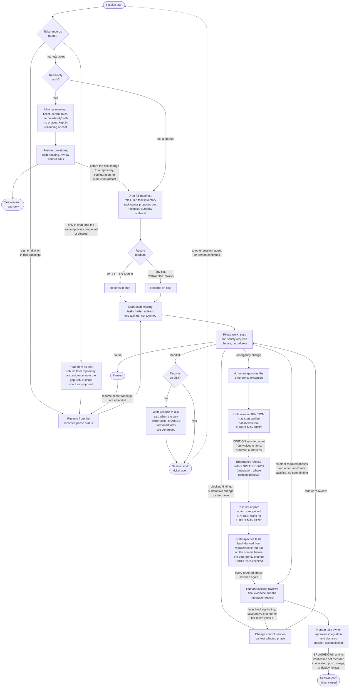
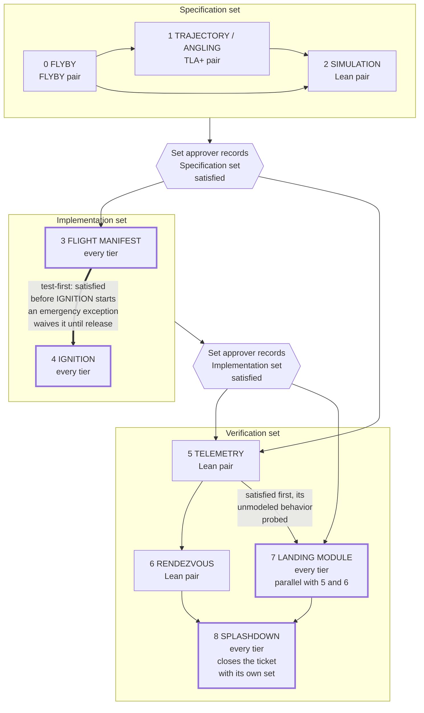
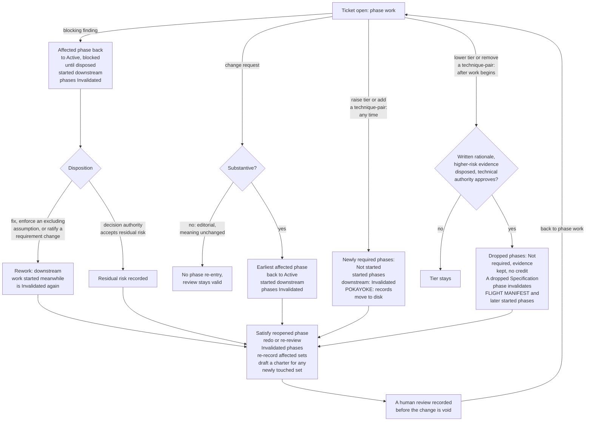
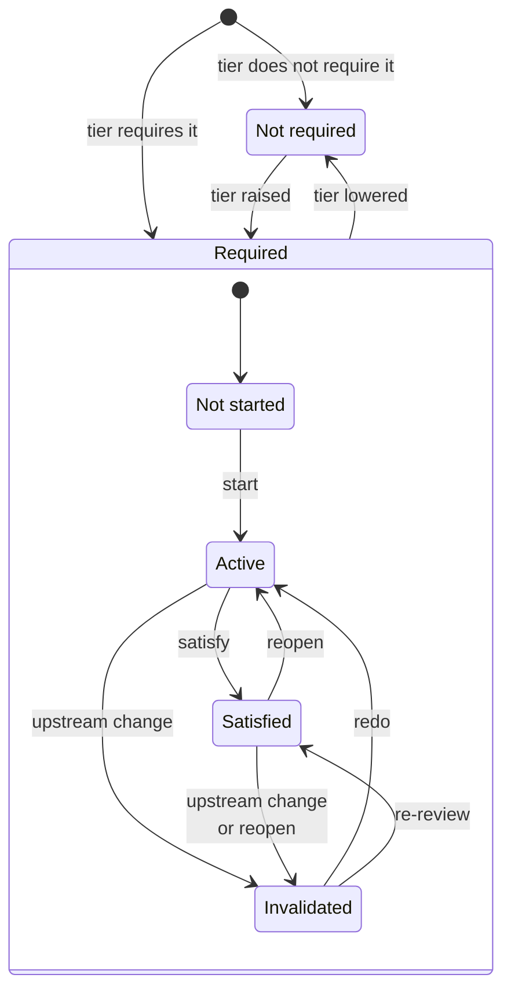
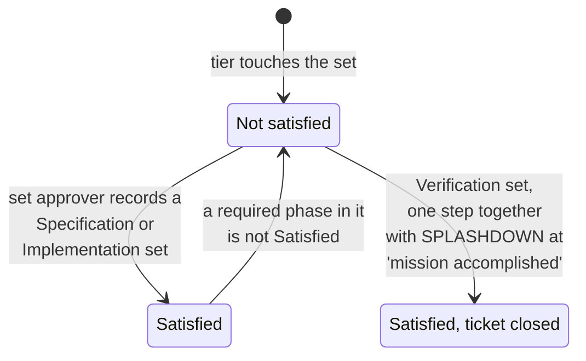

# AIDLC flow

These diagrams walk through every path a ticket can take under AIDLC, from
session start to session end. [AIDLC.md](AIDLC.md) is the source of truth: if
a diagram and AIDLC.md disagree, AIDLC.md wins. The diagrams were derived from
AIDLC.md and from [model/AIDLC.tla](model/AIDLC.tla), the TLC-checked process
model whose actions list every state transition. The table at the end maps each
action to the diagram that shows it. Regenerate the diagrams and the table
whenever either file changes.

## Session lifecycle

- The next diagrams expand "Phase work". [Findings and change
  control](#findings-and-change-control) expands "Change control".
- Default roles: the human user is task owner and reviewer, and the session
  agent holds the other four roles. A manifest may say "roles: default".
- Read-only work needs no disk, even at a handoff. Scratch files do not
  count as a change.
- A handoff is any point where another session, agent, or person continues
  the ticket. Resuming the same transcript is not a handoff, and neither is a
  sub-agent that reports back to the session.
- The human review covers the ratified tier and formal scope, and every
  risk acceptance, exception, tier lowering, and formal-scope change that an
  agent approved. Only a blocking finding, a substantive change, or a tier
  move voids it. Pauses, handoffs, and editorial changes do not.
- The compaction rule applies whenever compaction is noticed, not only at
  session start. Rebuilt requirements, ratifications, and approvals count
  as proposed until confirmed again, and requirements are never rebuilt
  from the code.
- A human can approve an emergency exception at any point before release.
  Without an early release, the ticket goes on through normal phase work.
- Where the repository uses no pull requests, the reviewed commit is the
  integration record, and the push or merge follows approval.
- Sources in AIDLC.md: Session flow, Record medium, Roles, SPLASHDOWN,
  Emergency changes.

## Phase pipeline by tier

| Tier | Required phases |
|---|---|
| WIFFLED — 0 / 3, none | The floor (thick border): FLIGHT MANIFEST, IGNITION, LANDING MODULE, SPLASHDOWN. |
| AIMED — 1 / 3, some | The floor, plus at least one technique-pair: FLYBY; TRAJECTORY / ANGLING; or SIMULATION → TELEMETRY → RENDEZVOUS. |
| POKAYOKE — 2 / 3, all | All nine phases. |

- Arrows show what a phase needs before it can be satisfied. Only phases the
  tier requires, and sets it touches, count. For example, SIMULATION needs
  FLYBY only when FLYBY is required.
- A phase may start drafting once its required inputs are in progress. It is
  satisfied only after they are satisfied and, for input from an earlier set,
  after that set is recorded satisfied.
- The thick arrow is test-first. It holds even when one task holds both
  phases. Until release, an approved emergency exception lets IGNITION start
  and be satisfied before FLIGHT MANIFEST. After release, test-first applies
  again.
- LANDING MODULE may start drafting once IGNITION is in progress, even before
  TELEMETRY starts. Its probes count once the Implementation set is
  satisfied. When TELEMETRY is required, LANDING MODULE is satisfied only
  after TELEMETRY is satisfied and its unmodeled behavior is probed.
- SPLASHDOWN needs every other phase and every other task's set satisfied.
  Its own Verification set is recorded with it, in one close step, when the
  human task owner declares "mission accomplished".
- Each set the tier touches needs at least one task. A task stays inside one
  set.
- AIMED and POKAYOKE manifests name a formal scope. Requirements outside it
  skip the formal phases but keep the ticket's tier, so WIFFLED-only
  relaxations do not apply to them.
- Sources in AIDLC.md: Structure, Tiers, each phase's Inputs, Test-first
  inside the set, Verification set, SPLASHDOWN.

## Findings and change control

- "Earliest affected phase" follows the re-entry examples in AIDLC.md,
  Change control.
- After an emergency release, a reopened IGNITION whose FLIGHT MANIFEST is
  not satisfied goes to Invalidated instead of Active. It waits there until
  FLIGHT MANIFEST is satisfied.
- When a phase is reopened or invalidated, its set's record drops. This
  includes a downstream task's set that was already recorded satisfied.
- Narrowing the formal scope after work begins follows the rule for lowering
  a tier.
- Sources in AIDLC.md: Known counterexamples require disposition, Selection
  rule, Change control, SPLASHDOWN.

## Phase status

- start: the set's task charter exists and each required input is at least
  in progress. LANDING MODULE needs only IGNITION in progress. IGNITION also
  needs FLIGHT MANIFEST satisfied, unless an emergency exception waives that
  before release.
- satisfy: required inputs are satisfied, upstream sets are recorded, no open
  blocking finding sits at or upstream of the phase, and the set approver
  records it. Before release, an emergency exception lets IGNITION skip
  FLIGHT MANIFEST here too. SPLASHDOWN is satisfied only at "mission
  accomplished".
- reopen: a blocking finding or substantive change names this phase as the
  earliest affected phase. After an emergency release, a reopened IGNITION
  whose FLIGHT MANIFEST is not satisfied goes to Invalidated, and waits there
  until FLIGHT MANIFEST is satisfied.
- upstream change: an upstream phase is reopened or fixed; a tier raise adds
  an upstream phase; a tier lowering drops a Specification phase, which
  invalidates FLIGHT MANIFEST and every started phase after it; or
  retrospective tests satisfy FLIGHT MANIFEST after an emergency IGNITION.
- redo and re-review: rework the phase, or re-review it against the changed
  input.
- The phase status template in AIDLC.md also lists Blocked and Reopened.
  Blocked is any phase at or downstream of an open blocking finding: it
  cannot be satisfied until the finding is disposed. Reopened is the reopen
  transition.

## Set record

## Coverage of AIDLC.tla actions

| AIDLC.tla action | Diagram | Shown by |
|---|---|---|
| ClassifyReadOnly | Session lifecycle | "Read-only work?" → yes → "Minimal manifest" |
| EndReadOnly | Session lifecycle | "Answer" → "Session end: read-only" |
| DraftManifest | Session lifecycle | "Draft full manifest", reached by "no: a change" or "before the first change to a repository, configuration, or production artifact", then "Record medium" → "Records in chat" or "Records on disk" |
| DraftCharter | Session lifecycle; Findings and change control | "Draft each missing task charter"; "draft a charter for any newly touched set" |
| WriteToDisk | Session lifecycle | "Records on disk?" → no → "Write records to disk" |
| StartPhase | Phase status; Phase pipeline by tier | "start" and "redo" transitions; the thick test-first arrow; the LANDING MODULE start note |
| CompletePhase | Phase status; Phase pipeline by tier; Session lifecycle | "satisfy" and "re-review" transitions; the arrows into each phase; "Retrospective tests land" (satisfying FLIGHT MANIFEST after IGNITION invalidates IGNITION for a re-check) |
| SatisfySet | Phase pipeline by tier; Set record | the "Set approver records ... satisfied" hexagons; "set approver records a Specification or Implementation set" |
| RaiseFinding | Findings and change control; Phase status | "blocking finding" → "Affected phase back to Active"; "reopen", or "upstream change or reopen" for IGNITION after release ("Test-first applies again" in Session lifecycle) |
| DisposeFix | Findings and change control | "Disposition" → "fix, enforce an excluding assumption, or ratify a requirement change" → "Rework" |
| DisposeAccept | Findings and change control | "Disposition" → "decision authority accepts residual risk" → "Residual risk recorded" |
| ChangeRequest | Findings and change control; Phase status | "change request" → "Substantive?" → yes → "Earliest affected phase back to Active"; "reopen", as for RaiseFinding |
| RaiseTier | Findings and change control; Phase status | "raise tier or add a technique-pair" → "Newly required phases"; "tier raised" |
| LowerTier | Findings and change control; Phase status | "lower tier or remove a technique-pair" → yes → "Dropped phases"; "tier lowered" |
| ApproveEmergency | Session lifecycle | "emergency change" → "A human approves the emergency exception" |
| EmergencyRelease | Session lifecycle | "IGNITION satisfied apart from waived criteria, a human authorizes" → "Emergency release before SPLASHDOWN" |
| Pause | Session lifecycle | "pause" → "Paused" |
| Resume | Session lifecycle | "Paused" → "resume same transcript" → "Resume from the recorded phase status" |
| Handoff | Session lifecycle | "handoff" → "Records on disk?" → "Session end: ticket open" |
| StartSession | Session lifecycle | dotted "another session, agent, or person continues" → "Session start" → "yes: on disk or in this transcript" |
| HumanReview | Session lifecycle | "Human reviewer reviews final evidence and the integration record" |
| HumanClose | Session lifecycle; Phase pipeline by tier; Set record | "Human task owner approves integration and declares 'mission accomplished'" and its edge "SPLASHDOWN and its Verification set recorded in one step"; "8 SPLASHDOWN ... closes the ticket with its own set"; "Verification set, one step together with SPLASHDOWN" |
| EndAfterClose | Session lifecycle | "Session end: ticket closed" |

`Terminated` in AIDLC.tla is the stutter step at a settled end, and `Hist`
only updates history variables that the checks read. Neither is a process
step, so no diagram shows them. Two paths come from AIDLC.md alone, with no
model action: rebuilding chat-only records lost to a compacted or cleared
transcript, and a read-only handoff.
