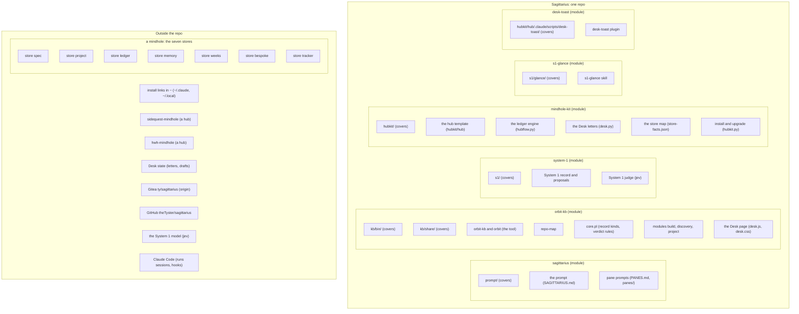
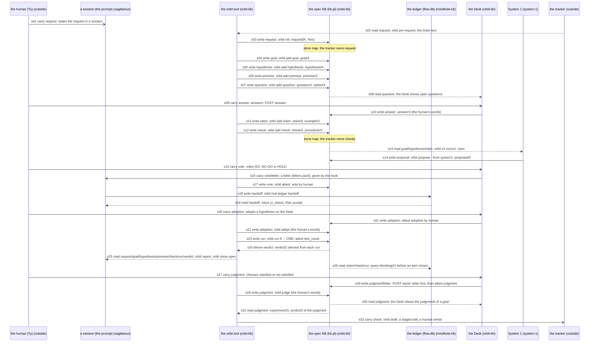

# Sagittarius map: groups and flow

Made by `python3 kb/share/repo-map/views.py build` from MODULES.json, hubkit/tools/store-facts.json and kb/share/repo-map/sagittarius.views.json. Do not edit: `views.py check` goes red when this file differs from its sources. The HTML page beside it (`sagittarius-map.html`) draws the same views as SVG.

## Groups view

## Flow view

## Sources of the arrows

| step | kinds | verb | from | to | what | sources (file, kind, name) |
|---|---|---|---|---|---|---|
| s01 | request | carry | human | session | states the request in a session | `prompt/SAGITTARIUS.md text ## The ticket` |
| s02 | request | read | tracker | tool | orbit pin-request: the ticket text | `kb/bin/orbit-kb kb_cmd pin-request` `kb/share/orbit-kb/core.pl decl request_pin` |
| s03 | request | write | tool | speckb | orbit init: request(R, Text) (store map: the tracker owns request) | `kb/bin/orbit-kb pred cmd_init` `kb/share/orbit-kb/core.pl decl request` |
| s04 | goal | write | tool | speckb | orbit add goal: goal/4 | `kb/bin/orbit-kb kb_cmd add` `kb/bin/orbit-kb pred cmd_add` `kb/share/orbit-kb/core.pl decl goal` |
| s05 | hypothesis | write | tool | speckb | orbit add hypothesis: hypothesis/4 | `kb/bin/orbit-kb pred cmd_add` `kb/share/orbit-kb/core.pl decl hypothesis` |
| s06 | premise | write | tool | speckb | orbit add premise: premise/3 | `kb/bin/orbit-kb pred cmd_add` `kb/share/orbit-kb/core.pl decl premise` |
| s07 | question | write | tool | speckb | orbit add question: question/3, option/3 | `kb/bin/orbit-kb pred cmd_add` `kb/share/orbit-kb/core.pl decl question` |
| s08 | question | read | speckb | desk | the Desk shows open questions | `kb/bin/orbit-kb route get /` `kb/bin/orbit-kb pred serve_answer_term` |
| s09 | answer | carry | human | desk | answers: POST /answer | `kb/bin/orbit-kb route post /answer` |
| s10 | answer | write | desk | speckb | answer/3 (the human's words) | `kb/bin/orbit-kb pred serve_answer_kb` `kb/share/orbit-kb/core.pl decl answer` |
| s11 | claim | write | tool | speckb | orbit add claim: claim/3, example/2 | `kb/bin/orbit-kb pred cmd_add` `kb/share/orbit-kb/core.pl decl claim` |
| s12 | check | write | tool | speckb | orbit add check: check/2, procedure/2 (store map: the tracker owns checks) | `kb/bin/orbit-kb pred cmd_add` `kb/share/orbit-kb/core.pl decl check` |
| s13 | goal/hypothesis/claim | read | speckb | s1 | orbit s1-record --json | `kb/bin/orbit-kb pred cmd_s1_record` `s1/record.py def fetch` |
| s14 | proposal | write | s1 | speckb | orbit propose --from system1: proposed/2 | `s1/record.py def propose` `kb/bin/orbit-kb kb_cmd propose` `kb/share/orbit-kb/core.pl decl proposed` |
| s15 | vote | carry | human | desk | votes GO, NO-GO or HOLD | `kb/bin/orbit-kb pred desk_kb_action` |
| s16 | vote/letter | carry | desk | session | a letter (letters.jsonl), given by the hook | `hubkit/hub/.claude/scripts/desk.py def cmd_send` `hubkit/hub/.claude/scripts/desk.py def run_hook` |
| s17 | vote | write | tool | speckb | orbit attest: vote by human | `kb/bin/orbit-kb pred cmd_attest` `kb/share/orbit-kb/modules/discovery.pl attest_type vote` |
| s18 | handoff | write | session | ledger | orbit hub ledger handoff | `hubkit/hub/.claude/scripts/hubflow.py def cmd_handoff` |
| s19 | handoff | read | ledger | session | inbox (v_inbox), then accept | `hubkit/hub/.claude/scripts/hubflow.py def cmd_accept` `hubkit/hub/.claude/scripts/hubflow.py text v_inbox` |
| s20 | adoption | carry | human | desk | adopts a hypothesis on the Desk | `kb/bin/orbit-kb pred desk_plan_adopt` |
| s21 | adoption | write | desk | speckb | attest adoption by human | `kb/bin/orbit-kb pred desk_effect` `kb/share/orbit-kb/core.pl attest_type adoption` |
| s22 | adoption | write | tool | speckb | orbit adopt (the human's words) | `kb/bin/orbit-kb kb_cmd adopt` `kb/bin/orbit-kb pred cmd_adopt` |
| s23 | run | write | tool | speckb | orbit run K -- CMD: attest test_result | `kb/bin/orbit-kb kb_cmd run` `kb/bin/orbit-kb pred cmd_run` `kb/share/orbit-kb/core.pl attest_type test_result` |
| s24 | verdict | derive | speckb | tool | verdict/2 derived from each run | `kb/share/orbit-kb/core.pl pred verdict` `kb/share/orbit-kb/core.pl pred experiment` |
| s25 | request/goal/hypothesis/premise/check/run/verdict | read | tool | session | orbit report, orbit show open | `kb/bin/orbit-kb kb_cmd report` `kb/bin/orbit-kb pred cmd_report` |
| s26 | claim/check/run | read | speckb | ledger | query blocking(X) before an item closes | `hubkit/hub/.claude/scripts/hubflow.py def query_blocking` `kb/share/orbit-kb/core.pl pred blocking` |
| s27 | judgment | carry | human | desk | chooses satisfied or not satisfied | `kb/bin/orbit-kb pred desk_judge_forms` |
| s28 | judgment/letter | write | desk | speckb | POST /send: letter first, then attest judgment | `kb/bin/orbit-kb route post /send` `kb/bin/orbit-kb pred desk_plan_judge` `kb/share/orbit-kb/core.pl attest_type judgment` |
| s29 | judgment | write | tool | speckb | orbit judge (the human's words) | `kb/bin/orbit-kb kb_cmd judge` `kb/bin/orbit-kb pred cmd_judge` |
| s30 | judgment | read | speckb | desk | the Desk shows the judgments of a goal | `kb/bin/orbit-kb pred desk_judgments_html` |
| s31 | judgment | read | speckb | tool | experiment/3, verdict/2 of the judgment | `kb/share/orbit-kb/core.pl pred experiment` |
| s32 | check | carry | tool | tracker | orbit draft: a staged edit; a human sends | `kb/bin/orbit-kb kb_cmd draft` `kb/share/orbit-kb/modules/project.pl decl draft` |

## Sources of the boxes

| box | source |
|---|---|
| `group:sagittarius` | `MODULES.json json sagittarius` |
| `part:covers:prompt` | `MODULES.json json prompt` |
| `part:prompt_main` | `prompt/SAGITTARIUS.md file prompt/SAGITTARIUS.md` |
| `part:prompt_panes` | `prompt/panes file prompt/panes` |
| `group:orbit-kb` | `MODULES.json json orbit-kb` |
| `part:covers:kb/bin` | `MODULES.json json kb/bin` |
| `part:covers:kb/share` | `MODULES.json json kb/share` |
| `part:orbit_tool` | `kb/bin/orbit-kb file kb/bin/orbit-kb` |
| `part:repo_map` | `kb/bin/repo-map file kb/bin/repo-map` |
| `part:core_pl` | `kb/share/orbit-kb/core.pl file kb/share/orbit-kb/core.pl` |
| `part:kb_modules` | `kb/share/orbit-kb/modules file kb/share/orbit-kb/modules` |
| `part:desk_page` | `kb/share/orbit-kb/desk file kb/share/orbit-kb/desk` |
| `group:system-1` | `MODULES.json json system-1` |
| `part:covers:s1` | `MODULES.json json s1` |
| `part:s1_record` | `s1/record.py file s1/record.py` |
| `part:s1_jev` | `s1/jev.py file s1/jev.py` |
| `group:mindhole-kit` | `MODULES.json json mindhole-kit` |
| `part:covers:hubkit` | `MODULES.json json hubkit` |
| `part:hub_template` | `hubkit/hub/CLAUDE.md file hubkit/hub/CLAUDE.md` |
| `part:ledger_engine` | `hubkit/hub/.claude/scripts/hubflow.py file hubkit/hub/.claude/scripts/hubflow.py` |
| `part:desk_py` | `hubkit/hub/.claude/scripts/desk.py file hubkit/hub/.claude/scripts/desk.py` |
| `part:store_map` | `hubkit/tools/store-facts.json file hubkit/tools/store-facts.json` |
| `part:hubkit_py` | `hubkit/tools/hubkit.py file hubkit/tools/hubkit.py` |
| `group:s1-glance` | `MODULES.json json s1-glance` |
| `part:covers:s1/glance` | `MODULES.json json s1/glance` |
| `part:s1_glance` | `s1/glance file s1/glance` |
| `group:desk-toast` | `MODULES.json json desk-toast` |
| `part:covers:hubkit/hub/.claude/scripts/desk-toast` | `MODULES.json json hubkit/hub/.claude/scripts/desk-toast` |
| `part:desk_toast` | `hubkit/hub/.claude/scripts/desk-toast/hooks/core.ts file hubkit/hub/.claude/scripts/desk-toast/hooks/core.ts` |
| `store:spec` | `hubkit/tools/store-facts.json json spec` |
| `store:project` | `hubkit/tools/store-facts.json json project` |
| `store:ledger` | `hubkit/tools/store-facts.json json ledger` |
| `store:memory` | `hubkit/tools/store-facts.json json memory` |
| `store:weeks` | `hubkit/tools/store-facts.json json weeks` |
| `store:bespoke` | `hubkit/tools/store-facts.json json bespoke` |
| `store:tracker` | `hubkit/tools/store-facts.json json tracker` |
| `outside:install_links` | `MODULES.json json installs` |
| `outside:sidequest_mindhole` | `hubkit/hub/.claude/scripts/desk.py def cmd_join` |
| `outside:hwh_mindhole` | `hubkit/hub/.claude/scripts/desk.py def cmd_join` |
| `outside:desk_state` | `hubkit/hub/.claude/scripts/desk.py def state_dir` |
| `outside:gitea` | `.git remote origin` |
| `outside:github` | `hubkit/README.md text github.com/theTyster/sagittarius` |
| `outside:s1_model` | `s1/jev.py text DEFAULT_MODEL =` |
| `outside:claude_code` | `hubkit/hub/.claude/scripts/desk.py def cmd_hooks` |
| `lane:human` | `prompt/SAGITTARIUS.md text ## Who judges what` |
| `lane:session` | `prompt/PANES.md text review` |
| `lane:tool` | `kb/bin/orbit-kb pred kb_cmd` |
| `lane:speckb` | `kb/share/orbit-kb/core.pl pred record_step` |
| `lane:ledger` | `hubkit/hub/.claude/scripts/hubflow.py def query_blocking` |
| `lane:desk` | `kb/bin/orbit-kb pred serve_act` |
| `lane:s1` | `s1/record.py def fetch` |
| `lane:tracker` | `kb/bin/orbit-kb pred cmd_pin_item` |
