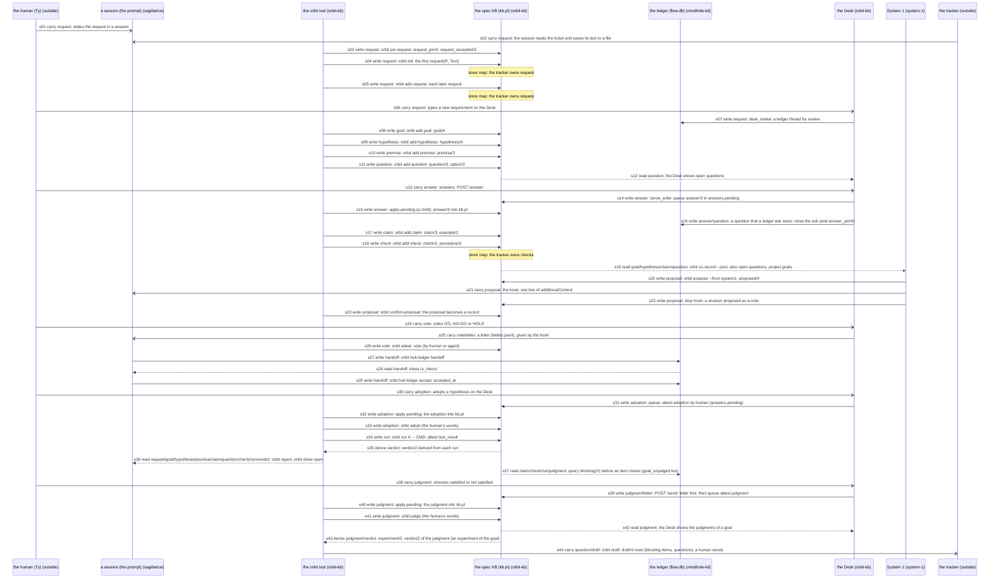

# Sagittarius map: groups and flow

Made by `python3 kb/share/repo-map/views.py build` from MODULES.json, hubkit/tools/store-facts.json and kb/share/repo-map/sagittarius.views.json. Do not edit: `views.py check` goes red when this file differs from its sources. The HTML page beside it (`sagittarius-map.html`) draws the same views as SVG.

## Groups view

```mermaid
flowchart TB
  subgraph repo["Sagittarius: one repo"]
    subgraph g_sagittarius["sagittarius (module)"]
      p_covers_prompt["prompt/ (covers)"]
      p_prompt_main["the prompt (SAGITTARIUS.md)"]
      p_prompt_panes["pane prompts (PANES.md, panes/)"]
    end
    subgraph g_orbit_kb["orbit-kb (module)"]
      p_covers_kb_bin["kb/bin/ (covers)"]
      p_covers_kb_share["kb/share/ (covers)"]
      p_orbit_tool["orbit-kb and orbit (the tool)"]
      p_repo_map["repo-map"]
      p_core_pl["core.pl (record kinds, verdict rules)"]
      p_kb_modules["modules build, discovery, project"]
      p_desk_page["the Desk page (desk.js, desk.css)"]
    end
    subgraph g_system_1["system-1 (module)"]
      p_covers_s1["s1/ (covers)"]
      p_s1_record["System 1 record and proposals"]
      p_s1_client["System 1 client of the model"]
    end
    subgraph g_mindhole_kit["mindhole-kit (module)"]
      p_covers_hubkit["hubkit/ (covers)"]
      p_hub_template["the hub template (hubkit/hub)"]
      p_ledger_engine["the ledger engine (hubflow.py)"]
      p_desk_py["the Desk letters (desk.py)"]
      p_store_map["the store map (store-facts.json)"]
      p_hubkit_py["install and upgrade (hubkit.py)"]
    end
    subgraph g_s1_glance["s1-glance (module)"]
      p_covers_s1_glance["s1/glance/ (covers)"]
      p_s1_glance["s1-glance skill"]
    end
    subgraph g_desk_toast["desk-toast (module)"]
      p_covers_hubkit_hub__claude_scripts_desk_toast["hubkit/hub/.claude/scripts/desk-toast/ (covers)"]
      p_desk_toast["desk-toast plugin"]
    end
  end
  subgraph outside["Outside the repo"]
    subgraph mh["a mindhole: the seven stores"]
      store_spec["store spec"]
      store_project["store project"]
      store_ledger["store ledger"]
      store_memory["store memory"]
      store_weeks["store weeks"]
      store_bespoke["store bespoke"]
      store_tracker["store tracker"]
    end
    o_install_links["install links in ~ (~/.claude, ~/.local)"]
    o_sidequest_mindhole["sidequest-mindhole (a hub)"]
    o_hwh_mindhole["hwh-mindhole (a hub)"]
    o_desk_state["Desk state (letters, drafts)"]
    o_gitea["Gitea ty/sagittarius (origin)"]
    o_github["GitHub theTyster/sagittarius"]
    o_s1_model["the System 1 model"]
    o_claude_code["Claude Code (runs sessions, hooks)"]
  end
  g_sagittarius -->|installs| o_install_links
  g_orbit_kb -->|installs| o_install_links
  g_orbit_kb -->|installs| o_install_links
  g_orbit_kb -->|installs| o_install_links
  g_orbit_kb -->|installs| o_install_links
  g_system_1 -->|installs| o_install_links
  g_s1_glance -->|installs| o_install_links
  g_desk_toast -->|installs| o_install_links
  g_mindhole_kit -->|installs| mh
  g_mindhole_kit -->|installs| mh
  g_orbit_kb -->|creates| store_spec
  g_orbit_kb -->|creates| store_project
  g_mindhole_kit -->|creates| store_ledger
  g_mindhole_kit -->|creates| store_memory
  g_mindhole_kit -->|creates| store_weeks
  p_orbit_tool -->|writes| store_spec
  p_desk_page -->|writes| store_spec
  p_kb_modules -->|writes| store_project
  p_ledger_engine -->|writes| store_ledger
  p_hubkit_py -->|writes| store_memory
```

## Sources of the lines of the groups view

| line | kind | from | to | what | sources (file, kind, name) |
|---|---|---|---|---|---|
| `install:sagittarius:~/.claude/sagittarius` | install | group:sagittarius | outside:install_links | ~/.claude/sagittarius links prompt | `MODULES.json json ~/.claude/sagittarius` `install.py def main` |
| `install:orbit-kb:~/.local/bin/orbit-kb` | install | group:orbit-kb | outside:install_links | ~/.local/bin/orbit-kb links kb/bin/orbit-kb | `MODULES.json json ~/.local/bin/orbit-kb` `install.py def main` |
| `install:orbit-kb:~/.local/bin/orbit` | install | group:orbit-kb | outside:install_links | ~/.local/bin/orbit links kb/bin/orbit | `MODULES.json json ~/.local/bin/orbit` `install.py def main` |
| `install:orbit-kb:~/.local/bin/repo-map` | install | group:orbit-kb | outside:install_links | ~/.local/bin/repo-map links kb/bin/repo-map | `MODULES.json json ~/.local/bin/repo-map` `install.py def main` |
| `install:orbit-kb:~/.local/share/orbit-kb` | install | group:orbit-kb | outside:install_links | ~/.local/share/orbit-kb links kb/share/orbit-kb | `MODULES.json json ~/.local/share/orbit-kb` `install.py def main` |
| `install:system-1:~/.claude/sagittarius-s1` | install | group:system-1 | outside:install_links | ~/.claude/sagittarius-s1 links s1 | `MODULES.json json ~/.claude/sagittarius-s1` `install.py def main` |
| `install:s1-glance:~/.claude/skills/s1-glance` | install | group:s1-glance | outside:install_links | ~/.claude/skills/s1-glance links s1/glance | `MODULES.json json ~/.claude/skills/s1-glance` `install.py def main` |
| `install:desk-toast:~/.claude/skills/desk-toast` | install | group:desk-toast | outside:install_links | ~/.claude/skills/desk-toast links hubkit/hub/.claude/scripts/desk-toast | `MODULES.json json ~/.claude/skills/desk-toast` `install.py def main` |
| `install:mindhole-kit:hub-engine` | install | group:mindhole-kit | outside:mindhole_stores | hubkit.py install copies the engine files and the owned files into a hub (kit.json engine, owned) | `hubkit/tools/hubkit.py def cmd_install` `hubkit/kit.json json engine` |
| `install:mindhole-kit:hub-orbit-kb` | install | group:mindhole-kit | outside:mindhole_stores | the kit copies kb/bin and kb/share into .claude/orbit-kb of a hub (kit.json orbit_kb) | `hubkit/kit.json json orbit_kb` `hubkit/tools/hubkit.py def okb_sources` |
| `creates:orbit-kb:spec` | creates | group:orbit-kb | store:spec | orbit-kb init makes a spec KB: a directory with kb.pl | `kb/bin/orbit-kb pred cmd_init` |
| `creates:orbit-kb:project` | creates | group:orbit-kb | store:project | orbit-kb init --uses project makes a project KB; its pins are kept in pins/ (the project module declares pin) | `kb/bin/orbit-kb pred cmd_init` `kb/share/orbit-kb/modules/project.pl decl pin` |
| `creates:mindhole-kit:ledger` | creates | group:mindhole-kit | store:ledger | hubflow.py init makes flow/flow.db from flow/seed.json | `hubkit/hub/.claude/scripts/hubflow.py def cmd_init` `hubkit/kit.json json flow/seed.json` |
| `creates:mindhole-kit:memory` | creates | group:mindhole-kit | store:memory | install writes the memory files (CLAUDE.md, HEURISTICS.md, TECHNOLOGIES.md: kit.json owned) into a hub | `hubkit/tools/hubkit.py def cmd_install` `hubkit/kit.json json HEURISTICS.md` |
| `creates:mindhole-kit:weeks` | creates | group:mindhole-kit | store:weeks | install writes W0/WEEK.md (kit.json owned); the rotation makes each new W0 | `hubkit/kit.json json W0/WEEK.md` `hubkit/hub/.claude/skills/hub-rotate/scripts/rotate.py text os.makedirs("W0"` |
| `writes:orbit_tool:spec` | writes | part:orbit_tool | store:spec | orbit-kb add and attest append records to kb.pl; apply-pending applies the Desk's waiting answers | `kb/bin/orbit-kb kb_cmd add` `kb/bin/orbit-kb kb_cmd attest` `kb/bin/orbit-kb kb_cmd apply-pending` |
| `writes:desk_page:spec` | writes | part:desk_page | store:spec | the Desk page posts an answer; orbit-kb serve queues it in answers.pending, then writes kb.pl | `kb/bin/orbit-kb route post /answer` `kb/bin/orbit-kb pred apply_pending` |
| `writes:kb_modules:project` | writes | part:kb_modules | store:project | orbit-kb pin-item writes a pin (a copy with a digest) to the project KB; the project module declares pin | `kb/bin/orbit-kb pred cmd_pin_item` `kb/share/orbit-kb/modules/project.pl decl pin` |
| `writes:ledger_engine:ledger` | writes | part:ledger_engine | store:ledger | hubflow.py is the only writer of flow/flow.db: it opens it read-write and adds items | `hubkit/hub/.claude/scripts/hubflow.py def connect_rw` `hubkit/hub/.claude/scripts/hubflow.py def cmd_add` |
| `writes:hubkit_py:memory` | writes | part:hubkit_py | store:memory | hubkit.py install and upgrade copy the memory files into a hub | `hubkit/tools/hubkit.py def cmd_install` `hubkit/tools/hubkit.py def cmd_upgrade` |

## Flow view

## Sources of the arrows

| step | kinds | verb | from | to | what | sources (file, kind, name) |
|---|---|---|---|---|---|---|
| s01 | request | carry | human | session | states the request in a session | `prompt/SAGITTARIUS.md text ## The ticket` |
| s02 | request | carry | tracker | session | the session reads the ticket and saves its text to a file | `kb/bin/orbit-kb text --request-file F: the text of the tracker item as you read it now` |
| s03 | request | write | tool | speckb | orbit pin-request: request_pin/4, request_accepted/3 | `kb/bin/orbit-kb kb_cmd pin-request` `kb/bin/orbit-kb pred cmd_pin_request` `kb/share/orbit-kb/core.pl decl request_pin` |
| s04 | request | write | tool | speckb | orbit init: the first request(R, Text) (store map: the tracker owns request) | `kb/bin/orbit-kb pred cmd_init` `kb/share/orbit-kb/core.pl decl request` |
| s05 | request | write | tool | speckb | orbit add request: each later request (store map: the tracker owns request) | `kb/bin/orbit-kb pred cmd_add` `kb/share/orbit-kb/core.pl decl request` |
| s06 | request | carry | human | desk | types a new requirement on the Desk | `kb/bin/orbit-kb route post /send` |
| s07 | request | write | desk | ledger | desk_intake: a ledger thread for review | `kb/bin/orbit-kb pred desk_intake` |
| s08 | goal | write | tool | speckb | orbit add goal: goal/4 | `kb/bin/orbit-kb kb_cmd add` `kb/bin/orbit-kb pred cmd_add` `kb/share/orbit-kb/core.pl decl goal` |
| s09 | hypothesis | write | tool | speckb | orbit add hypothesis: hypothesis/4 | `kb/bin/orbit-kb pred cmd_add` `kb/share/orbit-kb/core.pl decl hypothesis` |
| s10 | premise | write | tool | speckb | orbit add premise: premise/3 | `kb/bin/orbit-kb pred cmd_add` `kb/share/orbit-kb/core.pl decl premise` |
| s11 | question | write | tool | speckb | orbit add question: question/3, option/3 | `kb/bin/orbit-kb pred cmd_add` `kb/share/orbit-kb/core.pl decl question` |
| s12 | question | read | speckb | desk | the Desk shows open questions | `kb/bin/orbit-kb pred view_question_html` `kb/bin/orbit-kb pred serve_has_to_ask` |
| s13 | answer | carry | human | desk | answers: POST /answer | `kb/bin/orbit-kb route post /answer` |
| s14 | answer | write | desk | speckb | serve_write: queue answer/3 in answers.pending | `kb/bin/orbit-kb pred serve_write` `kb/share/orbit-kb/core.pl decl answer` |
| s15 | answer | write | tool | speckb | apply-pending (a child): answer/3 into kb.pl | `kb/bin/orbit-kb kb_cmd apply-pending` `kb/bin/orbit-kb pred cmd_apply_pending` |
| s16 | answer/question | write | desk | ledger | a question that a ledger ask owns: close the ask (and answer_pin/4) | `kb/bin/orbit-kb pred serve_owned` `kb/bin/orbit-kb pred desk_effect` `kb/share/orbit-kb/core.pl decl answer_pin` |
| s17 | claim | write | tool | speckb | orbit add claim: claim/3, example/2 | `kb/bin/orbit-kb pred cmd_add` `kb/share/orbit-kb/core.pl decl claim` |
| s18 | check | write | tool | speckb | orbit add check: check/2, procedure/2 (store map: the tracker owns checks) | `kb/bin/orbit-kb pred cmd_add` `kb/share/orbit-kb/core.pl decl check` |
| s19 | goal/hypothesis/claim/question | read | speckb | s1 | orbit s1-record --json: also open questions, project goals | `kb/bin/orbit-kb pred cmd_s1_record` `s1/record.py def fetch` `kb/bin/orbit-kb pred door_s1_ticket_` |
| s20 | proposal | write | s1 | speckb | orbit propose --from system1: proposed/4 | `s1/record.py def propose` `kb/bin/orbit-kb kb_cmd propose` `kb/share/orbit-kb/core.pl decl proposed` |
| s21 | proposal | carry | s1 | session | the hook: one line of additionalContext | `s1/hook.py text additionalContext` |
| s22 | proposal | write | s1 | speckb | stop hook: a revision proposed as a note | `s1/stop.py text record.propose` |
| s23 | proposal | write | tool | speckb | orbit confirm-proposal: the proposal becomes a record | `kb/bin/orbit-kb kb_cmd confirm-proposal` `kb/bin/orbit-kb pred cmd_confirm_proposal` |
| s24 | vote | carry | human | desk | votes GO, NO-GO or HOLD | `kb/bin/orbit-kb pred desk_kb_action` `kb/bin/orbit-kb pred desk_plan_act` |
| s25 | vote/letter | carry | desk | session | a letter (letters.jsonl), given by the hook | `hubkit/hub/.claude/scripts/desk.py def cmd_send` `hubkit/hub/.claude/scripts/desk.py def run_hook` |
| s26 | vote | write | tool | speckb | orbit attest: vote (by human or agent) | `kb/bin/orbit-kb pred cmd_attest` `kb/share/orbit-kb/modules/discovery.pl attest_type vote` |
| s27 | handoff | write | session | ledger | orbit hub ledger handoff | `hubkit/hub/.claude/scripts/hubflow.py def cmd_handoff` |
| s28 | handoff | read | ledger | session | inbox (v_inbox) | `hubkit/hub/.claude/scripts/hubflow.py text v_inbox` |
| s29 | handoff | write | session | ledger | orbit hub ledger accept: accepted_at | `hubkit/hub/.claude/scripts/hubflow.py def cmd_accept` `hubkit/hub/.claude/scripts/hubflow.py text accepted_at` |
| s30 | adoption | carry | human | desk | adopts a hypothesis on the Desk | `kb/bin/orbit-kb pred desk_plan_adopt` |
| s31 | adoption | write | desk | speckb | queue: attest adoption by human (answers.pending) | `kb/bin/orbit-kb pred desk_effect` `kb/bin/orbit-kb pred serve_write` `kb/share/orbit-kb/core.pl attest_type adoption` |
| s32 | adoption | write | tool | speckb | apply-pending: the adoption into kb.pl | `kb/bin/orbit-kb kb_cmd apply-pending` |
| s33 | adoption | write | tool | speckb | orbit adopt (the human's words) | `kb/bin/orbit-kb kb_cmd adopt` `kb/bin/orbit-kb pred cmd_adopt` |
| s34 | run | write | tool | speckb | orbit run K -- CMD: attest test_result | `kb/bin/orbit-kb kb_cmd run` `kb/bin/orbit-kb pred cmd_run` `kb/share/orbit-kb/core.pl attest_type test_result` |
| s35 | verdict | derive | speckb | tool | verdict/2 derived from each run | `kb/share/orbit-kb/core.pl pred verdict` `kb/share/orbit-kb/core.pl pred experiment` |
| s36 | request/goal/hypothesis/premise/claim/question/check/run/verdict | read | tool | session | orbit report, orbit show open | `kb/bin/orbit-kb kb_cmd report` `kb/bin/orbit-kb pred cmd_report` |
| s37 | claim/check/run/judgment | read | speckb | ledger | query blocking(X) before an item closes (goal_unjudged too) | `hubkit/hub/.claude/scripts/hubflow.py def query_blocking` `kb/share/orbit-kb/core.pl pred blocking` `kb/share/orbit-kb/modules/build.pl text blocking(goal_unjudged(G))` |
| s38 | judgment | carry | human | desk | chooses satisfied or not satisfied | `kb/bin/orbit-kb pred desk_judge_forms` |
| s39 | judgment/letter | write | desk | speckb | POST /send: letter first, then queue attest judgment | `kb/bin/orbit-kb route post /send` `kb/bin/orbit-kb pred desk_plan_judge` `kb/bin/orbit-kb pred serve_write` `kb/share/orbit-kb/core.pl attest_type judgment` |
| s40 | judgment | write | tool | speckb | apply-pending: the judgment into kb.pl | `kb/bin/orbit-kb kb_cmd apply-pending` |
| s41 | judgment | write | tool | speckb | orbit judge (the human's words) | `kb/bin/orbit-kb kb_cmd judge` `kb/bin/orbit-kb pred cmd_judge` |
| s42 | judgment | read | speckb | desk | the Desk shows the judgments of a goal | `kb/bin/orbit-kb pred desk_judgments_html` |
| s43 | judgment/verdict | derive | speckb | tool | experiment/3, verdict/2 of the judgment (an experiment of the goal) | `kb/share/orbit-kb/core.pl pred experiment` |
| s44 | question/draft | carry | tool | tracker | orbit draft: draft/4 rows (blocking items, questions); a human sends | `kb/bin/orbit-kb kb_cmd draft` `kb/share/orbit-kb/modules/project.pl decl draft` |

## What this map does not draw

- The lanes of the flow view have no line to their store; the lanes name it in the flow view.
- A line to a store is drawn only for the modules and parts listed as creating or writing it (module_stores, part_stores in the facts file): a part that only reads a store has none, and a store that no listed part writes (tracker) has none.
- The Desk letters (desk.py) and the Desk state are not a store: they have no line to one.
- orbit report: whether it reads judgments and adoptions was not confirmed (cmd_report names adoption once, judgment never); the s25 arrow does not carry them.
- Questions and answers of a ticket that waits in a ledger ask are drawn once (the Desk closes the ask); the ask itself is not traced.

## Sources of the boxes

| box | source |
|---|---|
| `group:sagittarius` | `MODULES.json json sagittarius` |
| `part:covers:prompt` | `MODULES.json json prompt` |
| `part:prompt_main` | `prompt/SAGITTARIUS.md file prompt/SAGITTARIUS.md` |
| `part:prompt_panes` | `prompt/panes file prompt/panes` |
| `group:orbit-kb` | `MODULES.json json orbit-kb` |
| `part:covers:kb/bin` | `MODULES.json json kb/bin` |
| `part:covers:kb/share` | `MODULES.json json kb/share` |
| `part:orbit_tool` | `kb/bin/orbit-kb file kb/bin/orbit-kb` |
| `part:repo_map` | `kb/bin/repo-map file kb/bin/repo-map` |
| `part:core_pl` | `kb/share/orbit-kb/core.pl file kb/share/orbit-kb/core.pl` |
| `part:kb_modules` | `kb/share/orbit-kb/modules file kb/share/orbit-kb/modules` |
| `part:desk_page` | `kb/share/orbit-kb/desk file kb/share/orbit-kb/desk` |
| `group:system-1` | `MODULES.json json system-1` |
| `part:covers:s1` | `MODULES.json json s1` |
| `part:s1_record` | `s1/record.py file s1/record.py` |
| `part:s1_client` | `s1/jev.py file s1/jev.py` |
| `group:mindhole-kit` | `MODULES.json json mindhole-kit` |
| `part:covers:hubkit` | `MODULES.json json hubkit` |
| `part:hub_template` | `hubkit/hub/CLAUDE.md file hubkit/hub/CLAUDE.md` |
| `part:ledger_engine` | `hubkit/hub/.claude/scripts/hubflow.py file hubkit/hub/.claude/scripts/hubflow.py` |
| `part:desk_py` | `hubkit/hub/.claude/scripts/desk.py file hubkit/hub/.claude/scripts/desk.py` |
| `part:store_map` | `hubkit/tools/store-facts.json file hubkit/tools/store-facts.json` |
| `part:hubkit_py` | `hubkit/tools/hubkit.py file hubkit/tools/hubkit.py` |
| `group:s1-glance` | `MODULES.json json s1-glance` |
| `part:covers:s1/glance` | `MODULES.json json s1/glance` |
| `part:s1_glance` | `s1/glance file s1/glance` |
| `group:desk-toast` | `MODULES.json json desk-toast` |
| `part:covers:hubkit/hub/.claude/scripts/desk-toast` | `MODULES.json json hubkit/hub/.claude/scripts/desk-toast` |
| `part:desk_toast` | `hubkit/hub/.claude/scripts/desk-toast/hooks/core.ts file hubkit/hub/.claude/scripts/desk-toast/hooks/core.ts` |
| `store:spec` | `hubkit/tools/store-facts.json json spec` |
| `store:project` | `hubkit/tools/store-facts.json json project` |
| `store:ledger` | `hubkit/tools/store-facts.json json ledger` |
| `store:memory` | `hubkit/tools/store-facts.json json memory` |
| `store:weeks` | `hubkit/tools/store-facts.json json weeks` |
| `store:bespoke` | `hubkit/tools/store-facts.json json bespoke` |
| `store:tracker` | `hubkit/tools/store-facts.json json tracker` |
| `outside:install_links` | `MODULES.json json installs` |
| `outside:sidequest_mindhole` | `hubkit/hub/.claude/scripts/desk.py def cmd_join` |
| `outside:hwh_mindhole` | `hubkit/hub/.claude/scripts/desk.py def cmd_join` |
| `outside:desk_state` | `hubkit/hub/.claude/scripts/desk.py def state_dir` |
| `outside:gitea` | `.git remote origin` |
| `outside:github` | `hubkit/README.md text github.com/theTyster/sagittarius` |
| `outside:s1_model` | `s1/jev.py text DEFAULT_MODEL =` |
| `outside:claude_code` | `hubkit/hub/.claude/scripts/desk.py def cmd_hooks` |
| `lane:human` | `prompt/SAGITTARIUS.md text ## Who judges what` |
| `lane:session` | `prompt/PANES.md text review` |
| `lane:tool` | `kb/bin/orbit-kb pred kb_cmd` |
| `lane:speckb` | `kb/share/orbit-kb/core.pl pred record_step` |
| `lane:ledger` | `hubkit/hub/.claude/scripts/hubflow.py def query_blocking` |
| `lane:desk` | `kb/bin/orbit-kb pred serve_act` |
| `lane:s1` | `s1/record.py def fetch` |
| `lane:tracker` | `kb/bin/orbit-kb pred cmd_pin_item` |
